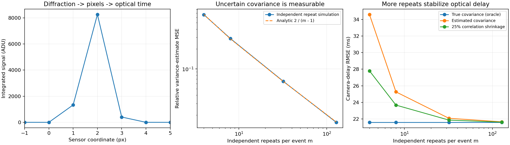

# Estimated clock covariance meets optical camera timing

A **45–60 minute learning lab** connecting diffraction, camera sampling, subpixel vision and finite-sample calibration statistics. Yesterday's [heteroscedastic-clock lab](https://github.com/ahmetalpkilic/heteroscedastic-clock-optical-timing-learning-lab) assumed each timestamp uncertainty ellipse was known. Here you estimate those ellipses from independent repeats and observe the resulting loss of optical-delay precision.

## Learn and run

Prerequisites: Gaussian noise, covariance, basic least squares, Fourier optics and Python. Objectives:

- Derive an optical spot's pixel-integrated signal and recover its subpixel center.
- Estimate timestamp covariance without using the evaluation observations or latent event times.
- Derive the variance of a sample-variance estimate and check it independently.
- Measure how noisy covariance weights affect a downstream camera-delay fit; assess a fixed shrinkage heuristic.

```sh
git clone https://github.com/ahmetalpkilic/estimated-clock-covariance-learning-lab.git
cd estimated-clock-covariance-learning-lab
sh run_demo.sh
```

Python 3.9–3.12 and a POSIX shell are required. First execution needs internet to install pinned dependencies into `.venv`; the deterministic simulation itself is offline and entirely synthetic. The runner executes twelve tests and writes `outputs/results.json` and `outputs/experiment.png`. Run `.venv/bin/python lab.py` to repeat offline. Reference outputs are in `examples/`. Allow a few minutes for installation; the simulation uses 800 outer trials at each of four repeat budgets.

Suggested session: 10 minutes optical model, 10 minutes covariance derivation, 10 minutes run and inspect, 10 minutes controlled comparison, 5–20 minutes exercises.

| Area | Model | What you infer or validate |
|---|---|---|
| Optics | Fourier transform of a Gaussian pupil, 550 nm wavelength | Diffraction sets the spot width |
| Camera | 16 mm focal length, 4 µm pixels, pixel integration and read noise | Pixel intensities constrain position |
| Vision/metrology | Subpixel spot fit along a known motion trajectory | Position provides optical time and camera delay |
| Mathematics | Sample covariance, Wishart moments, profile fitting and Monte Carlo | Limited calibration repeats change the delay error distribution |

## Physical model and conventions

The pupil amplitude is `exp(-(rho_x²+rho_y²)/a²)`, with amplitude radius `a=1000 µm`, wavelength `lambda=0.550 µm`, and focal length `f=16000 µm`. This is an **untruncated Gaussian pupil**, not a uniform circular aperture or an f-number model. Scalar paraxial monochromatic Fourier optics, an aberration-free isolated point and instantaneous exposure are assumed.

The Fourier amplitude is proportional to `exp(-(pi*a*x/(lambda*f))²)`. Squaring gives intensity SD `lambda*f/(2*pi*a)`. At pixel pitch `p=4 µm`,

```text
sigma_px = lambda*f/(2*pi*a*p) = 0.350140875 px
mu_j(u) = B + F [Phi((j+0.5-u)/sigma) - Phi((j-0.5-u)/sigma)]
```

`Phi` is the standard-normal CDF; `F=10000 ADU`, `B=20 ADU`. The camera has square pixels, no distortion/skew, principal point `(0,0)` and `K=diag(4000,4000,1)` in pixels. We simulate the horizontal marginal of a separable 2-D PSF. Signed ROI pixel centers are `j=-16,...,+16`, increasing to the right; each integrates `[j-0.5,j+0.5]`. These are not top-left array coordinates.

Each marginal sample receives independent Gaussian read noise of SD 2 ADU. There is no shot noise, saturation, quantization, or photometry fitting; flux, background and optical width are known. Least squares fits `u` using the analytic pixel-integral derivative. This high-SNR toy model isolates clock uncertainty, not a full camera noise budget.

The independently known image trajectory is `u(r)=u0+v*r`, `u0=0.23 px`, `v=0.8 px/reference second`. Clocks obey `r=alpha*t+beta`: true `alpha=1.002 reference s/master s`, `beta=0.030 reference s`. A frame tagged `T=2.0 master s` was exposed at `T+delta`, with true delay `delta=0.040 master s`.

Forty synchronization events span `[-1,+1] master s`. The true event times are **withheld from the estimator**. Even events have timestamp SDs `(0.030,0.020) s`, correlation 0.5. Odd events have SDs `(0.240,0.020*sqrt(8)) s`, correlation 0.2. This fixes yesterday's heterogeneity at `h=8`. Covariances have units s². Calibration is extrapolated to the frame time beyond the sync interval.

## New experiment: estimate the ellipses

For each event setting `i`, independently repeat the same fixed true timestamp pair `m` times:

```text
w_ik = mu_i + eta_ik,   eta_ik ~ N(0,C_i),  k=1,...,m
wbar_i = mean_k(w_ik)
S_i = sum_k (w_ik-wbar_i)(w_ik-wbar_i)^T / (m-1)
```

`mu_i` is unknown to the estimator and disappears after centering. The repeat experiment requires a reproducible fixed pair, or independently corrected timestamps with the same residual covariance. Merely collecting timestamps from different true event times would confound trajectory spread with timing noise. This experimental assumption is substantive.

The evaluation synchronization pairs are **new independent single observations** with covariance `C_i`. They are not the repeat means, so the weights use `S_i`, **not `S_i/m`**. The repeat means never enter the synchronization fit. All events, repeat errors and camera noise are independent; no common jitter or drift is modeled. A fresh repeat dataset is drawn in every outer trial, so reported error includes calibration-estimation variability. Repeat counts `m=4,8,32,128` correspond to `40*m` training pairs, plus 40 independent evaluation pairs per outer trial. Nested prefixes pair repeat budgets for fair comparison.

### Derive a checkable prediction

For Gaussian data, subtracting the mean projects `m` independent samples into a subspace of rank `nu=m-1`. After an orthogonal rotation there are `nu` independent zero-mean Gaussian vectors, so `nu*S` is their sum of outer products (a Wishart matrix). Using Gaussian fourth moments,

```text
E[S_ab] = C_ab
Cov(S_ab,S_cd) = (C_ac*C_bd + C_ad*C_bc) / (m-1)
Var(S_xx) = 2*C_xx²/(m-1)
E[(S_xx/C_xx - 1)²] = 2/(m-1)
```

For example `m=4` gives relative variance-estimate MSE `2/3`; `m=128` gives `2/127`. The test suite independently checks diagonal and off-diagonal moments across 50,000 draws. Although `S` is unbiased, inverse weights and the fitted delay are nonlinear functions of it: unbiased covariance does not imply unchanged delay precision or unbiased delay.

### From estimated covariance to clock calibration

Treat `S_i` as a plug-in covariance, temporarily fixed during each fit. With latent true time `tau_i`, minimize

```text
Q = sum_i [z_i-(tau_i,alpha*tau_i+beta)]^T S_i^-1
          [z_i-(tau_i,alpha*tau_i+beta)]
```

For `d=(1,alpha)`, differentiation gives

```text
tau_i* = d^T S_i^-1 (x_i,y_i-beta) / (d^T S_i^-1 d).
V_i(alpha) = alpha²*S_i,xx - 2*alpha*S_i,xy + S_i,yy
Q_profile = sum_i (y_i-alpha*x_i-beta)²/V_i(alpha)
beta*(alpha) = sum_i [(y_i-alpha*x_i)/V_i] / sum_i [1/V_i].
```

Search numerically over `alpha in [0.5,1.5]`. The implementation checks a 65-point grid, refines bracketed minima and rejects boundary/flat fits. This is not a global-optimum guarantee for arbitrary data. Independent full latent-event optimization validates the implemented objective. There is no `log V_i` term: this profiles fixed latent times; it does not marginalize random times. With estimated covariance, this is a **plug-in procedure**, not the full likelihood jointly accounting for covariance uncertainty. We make no confidence-interval or coverage claim.

Finally,

```text
r_hat = (u_hat-u0)/v
 delta_hat = (r_hat-beta_hat)/alpha_hat - T
 d(delta) ≈ du/(v*alpha) - d(beta)/alpha - (T+delta)*d(alpha)/alpha.
```

Thus precise optical localization can coexist with poor delay precision when calibration weights are uncertain and rate errors are extrapolated.

## Controlled comparison and annotated code

Each method sees identical optical centers and evaluation timestamps:

1. **Oracle:** use the true `C_i` (simulation-only reference).
2. **Estimated:** use independent repeat covariance `S_i`.
3. **Shrunk:** use `0.75*S_i + 0.25*diag(S_i)`. This preserves marginal variances and reduces correlations. It is a fixed heuristic chosen before simulation, not an optimized estimator. At large `m` it converges to an incorrect covariance when true correlations are nonzero; any improvement at small `m` is a tradeoff, not a universal guarantee.

`optics.py` implements pupil width, integrated signal, derivative and localization. `clock_model.py` contains the attributed predecessor's covariance model, latent-time elimination, checked rate search and delay conversion. New `lab.py::sample_covariance` estimates centered ellipses; `shrink_correlation` defines the controlled regularization; `demo` keeps random streams separate and redraws independent calibration repeats on each trial. `test_lab.py` checks NumPy agreement, unit/translation invariance, Wishart moments, shrinkage, an independent-seed repeat-budget effect and full latent optimization with estimated ellipses. `test_clock_model.py` preserves seven independent optics/calibration checks.

Every failed fit is counted; the demo exits unsuccessfully if any fail. Summary statistics would then be conditional on success and must not be treated as unconditional performance. Covariance arrays must be positive definite; fewer than three repeats or degenerate data are rejected. No eigenvalue clipping silently manufactures an uncertainty floor.

## Expected results

| Repeats/event | Oracle RMSE (ms) | Estimated RMSE (ms) | Shrunk RMSE (ms) |
|---:|---:|---:|---:|
| 4 | 21.595 | 34.603 | 27.804 |
| 8 | 21.595 | 25.267 | 23.672 |
| 32 | 21.595 | 22.082 | 21.865 |
| 128 | 21.595 | 21.652 | 21.614 |

Noiseless recovered delay: **40.0000004 ms**. Optical center SD: **0.0002617 px**. All 800 trials succeeded at every repeat budget for every method. At four repeats, the estimated-covariance mean delay error is **−0.532 ms**, with **1.224 ms MCSE**; this is not evidence of a resolved systematic bias. Its measured relative variance-estimate MSE is **0.66294**, versus the analytic **0.66667**.


JSON includes mean error, sample SD, RMSE, 95th percentile absolute error and Monte Carlo standard error of the mean. The latter quantifies uncertainty of the simulation's estimated bias, not a device confidence interval. Do not interpret small mean differences without their MCSE. The plot compares the observed covariance error with `2/(m-1)` and shows its effect on optical-delay RMSE. Repeated output is deterministic with the pinned environment; platforms may differ in final digits.



## Exercises

1. Predict the repeat count needed for variance-estimate relative RMS error below 20%, using `sqrt(2/(m-1))`. Simulate that budget.
2. Replace fixed 25% shrinkage with strengths 0, 0.1, 0.5 and 1. Use a separate seed to evaluate your chosen strength. Explain why selecting and reporting on the same trials is optimistic.
3. Pool repeat residuals within the two known quality classes. Derive the correct degrees of freedom when each event has a different unknown mean. Compare its precision and state the extra shared-covariance assumption.
4. Move the camera frame from `T=2` to `T=0`. Recompute its true spot center. Predict how clock-rate uncertainty changes the delay RMSE.
5. Add random common drift to all training repeats. Explain which Wishart assumptions fail and why collecting more correlated repeats can give misleading certainty.

## Limits and next lesson

This isolates finite-sample covariance estimation. True optical model, flux, background, motion, affine clocks and reproducible repeat settings are assumed. Finite exposure, shot noise, drift, outliers, inaccurate repeat labels and unknown photometry are excluded. A tiny ellipse can excessively weight an event; small repeat counts are fragile. A known-covariance oracle is a benchmark, not a proof that its finite-sample RMSE is minimal among all possible estimators. No measured hardware data or uncertainty coverage validation is included. **Numerical recovery and synthetic repeatability are not instrument accuracy or traceability.**

Next focused lesson: pool covariance information across independently repeated events with known quality classes, then deliberately violate the shared-covariance assumption to expose the precision-versus-mismatch tradeoff. Do not repeat today's independent per-event estimation experiment.

## Attribution and reviewed sources

Original new repeat-estimation code and synthetic outputs: MIT. `clock_model.py`, `optics.py`, `test_clock_model.py`, dependency pins and runner reuse/adapt [the MIT predecessor](https://github.com/ahmetalpkilic/heteroscedastic-clock-optical-timing-learning-lab/tree/36dbdf5ec4d19a5002a2d2f05905ef202a735950), copyright 2026 ahmetalpkilic. Its license is preserved; its optical model in turn originated in the same author's correlated-clock lab. The new work changes the known-covariance assumption into an independently estimated one and adds repeat-budget and shrinkage experiments.

Reviewed [prysm](https://github.com/brandondube/prysm) for Fourier-optics context (MIT; no code copied), [SciPy Wishart documentation](https://docs.scipy.org/doc/scipy/reference/generated/scipy.stats.wishart.html) for the sampling distribution, and current public NumPy/SciPy/Matplotlib repositories for numerical tools. `sources.json` records exact reviewed commits, commit/push dates, recent change descriptions and pinned license URLs; full license texts are retained in `licenses/`. NumPy and SciPy use BSD-3-Clause notices; Matplotlib's permissive agreement is preserved. Installed distributions retain bundled third-party notices. Current source-review commits are distinct from runtime versions pinned in `requirements.txt`; no claim that the newest upstream commits were executed.
